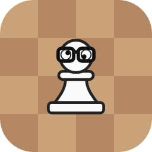
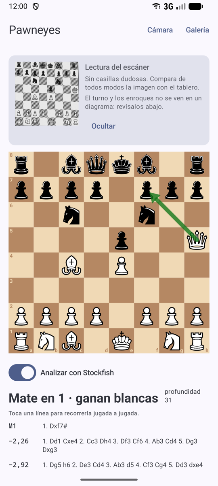
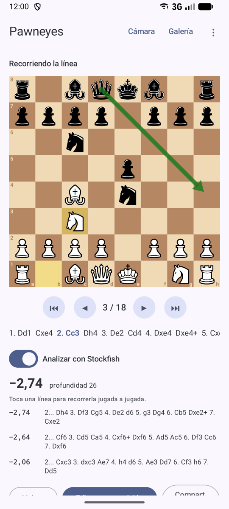
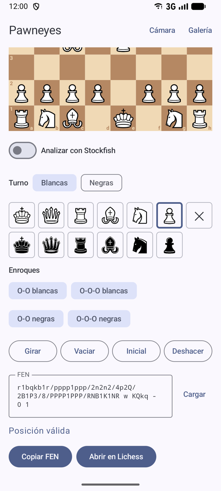
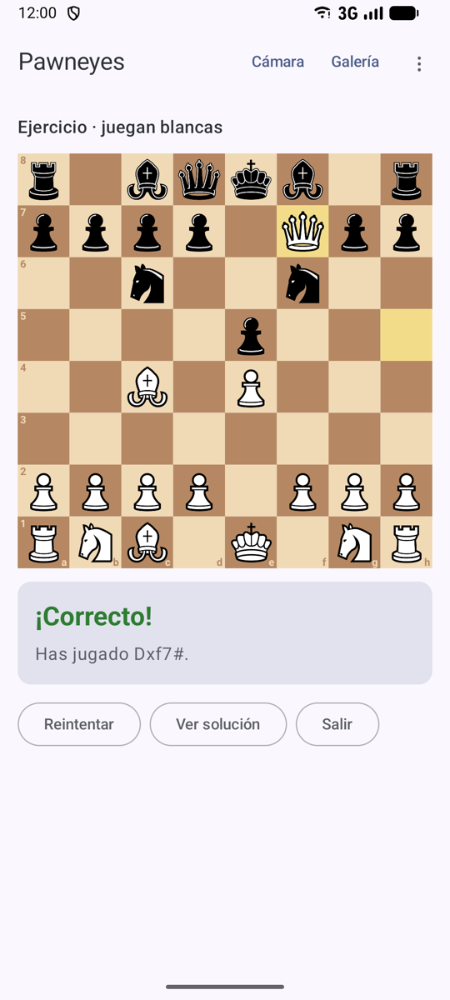
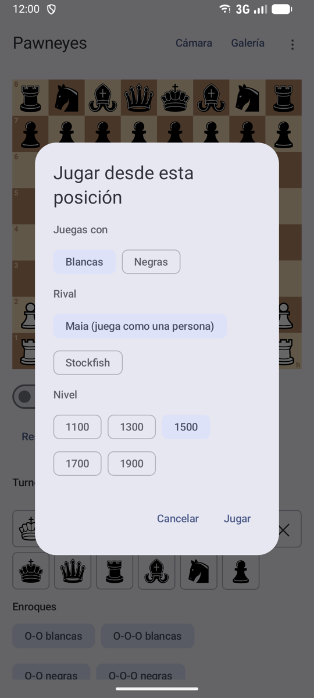
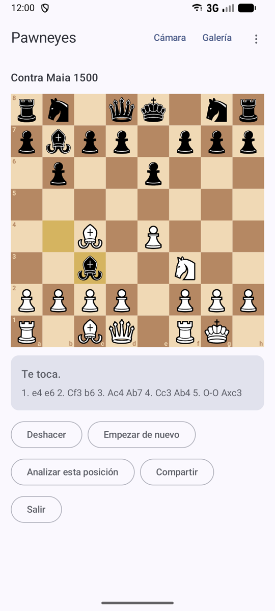

<p align="center">
  
</p>

<h1 align="center">Pawneyes</h1>

<p align="center">
  Escanea con el móvil un diagrama de ajedrez de un libro, conviértelo en una posición editable y analízala con Stockfish.
</p>

<p align="center">
  <a href="https://apps.obtainium.imranr.dev/redirect?r=obtainium://add/https://github.com/ilismal/pawneyes">
    
  </a>
</p>

> [!NOTE]
> **Esto es un proyecto hobby para aprender**: visión por ordenador, entrenamiento de un
> clasificador con datos sintéticos, Android con Compose, CameraX y un motor de ajedrez.
> Funciona razonablemente con los libros con los que lo he probado, pero no está pensado
> para competir con nada. Si lo que quieres es escanear diagramas de verdad, mejor usa
> [chessvision.ai](https://chessvision.ai) o aplicaciones similares, que son mucho más
> completas y fiables.

<p align="center">
  
  &nbsp;
  
  &nbsp;
  
</p>
<p align="center">
  
  &nbsp;
  
  &nbsp;
  
</p>

## Qué hace

- **Escanea un diagrama** desde la cámara (con autocaptura cuando el tablero se queda quieto),
  desde la galería o compartiendo una foto con la app. Detecta el tablero aunque la foto esté
  girada o en perspectiva, y marca en rojo las casillas de las que no está seguro.
- **Lee el texto de la página** (con Tesseract, en el móvil): el turno, si el pie lo dice
  («Juegan las negras», «White to move») o se deduce de la jugada impresa junto al diagrama
  («5.Cf3», «19. ..., T1A»), y si el diagrama está impreso desde el lado de las negras (por
  las coordenadas o, si no las hay, por los peones). Si se equivoca, se corrige con un toque.
- **Editor de posiciones**: colocar y quitar piezas, turno, enroques, FEN, deshacer, avisos de
  posiciones imposibles (reyes que faltan, peones en la 1ª fila, jaque al bando que no mueve…).
- **Análisis con Stockfish 16** dentro de la app: evaluación, las tres mejores líneas en notación
  algebraica española (R, D, T, A, C) y una flecha con la mejor jugada.
- **Recorrer las líneas** jugada a jugada; el motor sigue analizando la posición que estás viendo.
- **Modo ejercicio**: busca la mejor jugada sin ver la evaluación; la app la compara con la de
  Stockfish y te dice si es correcta, una imprecisión o un error (y cuánto pierdes).
- **Jugar desde cualquier posición** contra Stockfish (de 1350 de Elo a plena fuerza) o contra
  [Maia](https://maiachess.com) (1100–1900), una red entrenada con partidas de Lichess para jugar
  como una persona de ese nivel, errores incluidos. Con deshacer y la partida en PGN.
- Copiar el FEN, abrir la posición en Lichess o compartirla como PGN o como imagen.
- **Historial de escaneos**: cada escaneo se guarda (miniatura, posición con tus correcciones y
  fecha) y se puede etiquetar con el libro y la página, buscar y volver a abrir en el editor.
- **Guardar escaneos corregidos** para mejorar el modelo con tus propios libros (ver abajo).

Requiere Android 8.0 o superior en un móvil ARM64 (casi todos los actuales). La APK ocupa unos
72 MB, más de la mitad por la red neuronal de Stockfish.

## Instalación

- Con **[Obtainium](https://github.com/ImranR98/Obtainium)**: pulsa el botón de arriba desde el
  móvil. Obtainium avisa de las nuevas versiones.
- A mano: descarga la APK de la última [release](https://github.com/ilismal/pawneyes/releases).

## Cómo funciona

```
foto ─► detector del tablero (OpenCV) ─► tablero enderezado 512×512
     ─► 64 casillas ─► CNN pequeña (LiteRT) en las 4 rotaciones
     ─► elegir rotación + reglas de legalidad ─► posición
     ─► texto alrededor (Tesseract): ¿negras abajo? ¿turno? ─► editor / Stockfish
```

1. **Detector** (`ml/detect`, portado a `android/vision`): binarización adaptativa, casillas
   oscuras agrupadas por vecindad diagonal, homografía y un ajuste fino que maximiza el
   contraste de tablero de ajedrez. No necesita que el diagrama tenga marco.
2. **Clasificador de casillas** (`ml/train`): una CNN de ~300 000 parámetros, 13 clases (vacía +
   6 piezas × 2 colores). Se entrena **sobre todo con diagramas sintéticos**: el generador
   (`ml/synth`) dibuja tableros con 25 juegos de piezas (y reserva otros 3 para validar) y distintos estilos de casilla
   (rayado, punteado, gris liso…) y simula la foto (perspectiva, curvatura de la página,
   sombras, desenfoque, ruido, JPEG). Después se ajusta con unas pocas fotos reales.
3. **Rotación y legalidad**: se prueban las 4 orientaciones y se elige la de mayor confianza en
   las casillas ocupadas; luego se corrigen errores imposibles (un rey de cada color, máximo de
   peones…) usando la segunda opción del modelo.
4. **Texto de la página** (`ml/caption`): con la homografía del tablero se endereza también la
   página de alrededor y se pasa por Tesseract (modelo rápido de español). Del texto más cercano
   se saca el turno, con reglas que se fían de la estructura (número + jugadas) y no de leer bien
   cada jugada, y de las coordenadas impresas, la orientación. Si no hay coordenadas, cuenta la
   posición de los peones: en 2 200 posiciones de partidas de Maia contra sí misma no dio ni un
   falso positivo, y reconoce un tablero girado en el 96–100 % de las aperturas y medios juegos
   (en los finales, con pocos peones, solo una de cada cuatro veces).

La implementación Android reproduce exactamente la de Python: hay tests que comparan cada paso
(esquinas del detector, recorte, salidas del modelo, rotación, reglas, orientación y turno) contra fixtures
generados en Python. Los del repositorio (`fixtures-publicos/`) salen de diagramas sintéticos,
así que el CI los ejecuta en cada cambio.

**Precisión**: en mis 10 fotos de prueba (que no se publican, ver abajo) acierta el 99,4 % de las
casillas y lee 8 de los 10 tableros sin ningún error. Funciona mejor con los libros que ha
visto en el ajuste fino; con estilos de pieza muy distintos se equivoca más.

## Estructura

```
android/            App (Kotlin, Jetpack Compose)
  core/chess/       Posición, FEN, generador de jugadas (verificado con perft), notación
  vision/           Detector, recorte y clasificador (OpenCV 5 + LiteRT)
  engine/           Stockfish 16 por UCI (se compila con el NDK al compilar la app)
  maia/             Maia 1 en LiteRT: codificación de lc0 y elección de jugada
  feature/board/    Tablero y editor
  feature/camera/   Cámara con detección en vivo y autocaptura
  app/              Pantallas, análisis y explorador de líneas
ml/                 Python: generador sintético, detector, entrenamiento, texto de la página y exportación
fixtures-publicos/  Fixtures sintéticos para los tests de paridad Python/Android (y de Maia)
```

## Compilar

### App

Necesitas JDK 21, el SDK de Android (lo más cómodo: Android Studio) y el NDK de la versión
de `android/gradle/libs.versions.toml` (en Android Studio: SDK Manager → SDK Tools → NDK).

```sh
cd android
./gradlew :app:assembleDebug          # APK de depuración en app/build/outputs/apk/debug/
./gradlew :core:chess:test            # tests JVM
./gradlew :vision:connectedDebugAndroidTest   # paridad con Python, en un móvil o emulador
```

Stockfish 16 se compila desde su código fuente oficial la primera vez (unos segundos): las
fuentes y la red neuronal se descargan y se comprueba su SHA-256. Es la 16 y no una posterior
porque desde la 16.1 las redes pasan de 100 MB, y eran casi toda la APK; para analizar
posiciones de un libro sobra. El modelo ya entrenado está en `ml/models/square_net.tflite`.

Para una APK release firmada, crea `android/release.jks` y `android/keystore.properties`
(`storeFile`, `storePassword`, `keyAlias`, `keyPassword`). El workflow
`.github/workflows/release.yml` hace lo mismo en GitHub Actions al publicar una etiqueta `vX.Y.Z`.

### Mejorar el modelo con tus escaneos

El modelo acierta mejor con los libros que ha visto. Para enseñarle los tuyos:

1. En la app, tras escanear un diagrama, corrige las casillas que hagan falta y pulsa
   **«Guardar para entrenar»**. Se guarda la foto (reducida, ya derecha y sin metadatos EXIF
   ni GPS) con la posición del tablero; no sale del móvil hasta que la exportes.
2. Cuando tengas unas cuantas, en el menú ⋮, **«Exportar para entrenar»** y pásate el ZIP al
   ordenador.
3. Impórtalo y haz un ajuste fino:

   ```sh
   cd ml
   uv run python -m train.import_scans ~/Downloads/pawneyes-entrenamiento-AAAAMMDD.zip
   uv run python -m train.train --init models/square_net.pt --real-frac 0.3 \
       --epochs 4 --lr 5e-4 --out models/ft
   uv run python -m train.evaluate models/ft/square_net.pt   # compáralo con el actual
   cp models/ft/square_net.pt models/square_net.pt
   uv run python -m export.export_tflite                    # el modelo que usa la app
   uv run python -m export.public_fixtures                  # fixtures de los tests
   ```

Con solo 7 fotos de un libro, sus diagramas pasaron de 10 casillas mal a ninguna.

### Modelo (opcional)

Con [uv](https://docs.astral.sh/uv/):

```sh
cd ml
uv run python -m synth.download_pieces       # juegos de piezas de Lichess
uv run python synth/pieces.py                # rasterizarlos
uv run python -m train.train --epochs 12     # entrenar (solo con datos sintéticos)
uv run python -m export.export_tflite        # exportar a TFLite y comprobar que coincide
```

Las redes de Maia ya convertidas están en `ml/models/maia/`. Para regenerarlas desde los pesos
originales de lc0:

```sh
for e in 1100 1300 1500 1700 1900; do
  curl -LO https://github.com/CSSLab/maia-chess/raw/master/maia_weights/maia-$e.pb.gz
done
uv run python maia/export.py .              # LiteRT + fixtures-publicos/maia.json
```

Las fotos de evaluación (`ejemplos/`), las del ajuste fino (`entrenamiento/`) y los fixtures que
salen de ellas (`fixtures/`) **no se publican**: son páginas de libros con derechos de autor.
Para usar las tuyas, pon fotos con su `.fen` (solo la parte de piezas) en `ejemplos/` y genera
los fixtures con `uv run python -m export.fixtures`; los tests los usarán además de los públicos.

Los fixtures públicos se regeneran (de forma determinista) con
`uv run python -m export.public_fixtures`, tras descargar y rasterizar las piezas. Solo usan
juegos de piezas con licencias libres (Apache 2.0, MIT, CC0). Los casos de las reglas de turno y
orientación (`fixtures-publicos/caption.json`) salen de `uv run python -m caption.cases`. Para
leer el texto en Python hace falta Tesseract instalado (`brew install tesseract`); el modelo de
español está en `ml/models/tessdata/`.

## Licencia

[GPLv3](LICENSE). La app incluye [Stockfish](https://stockfishchess.org) (GPLv3), las piezas
[chessnut](https://github.com/LexLuengas/chessnut-pieces) de Alexis Luengas (Apache 2.0),
OpenCV, LiteRT y Tesseract (Apache 2.0) y las redes de [Maia](https://github.com/CSSLab/maia-chess)
(GPLv3), convertidas a LiteRT con `ml/maia/export.py`: ver [android/LICENSES.md](android/LICENSES.md).
